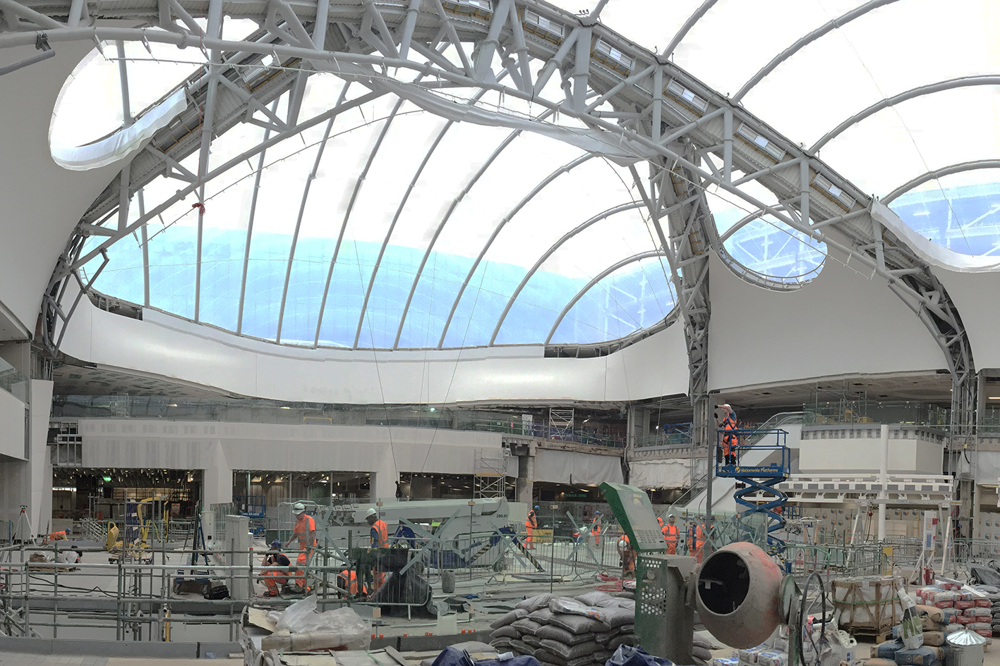
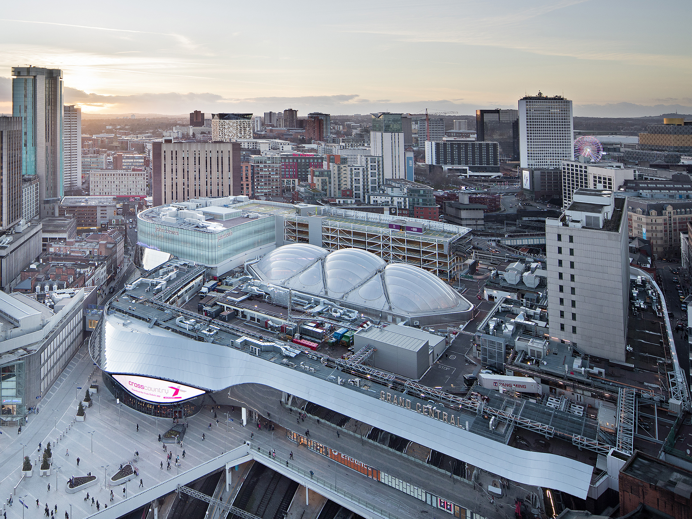
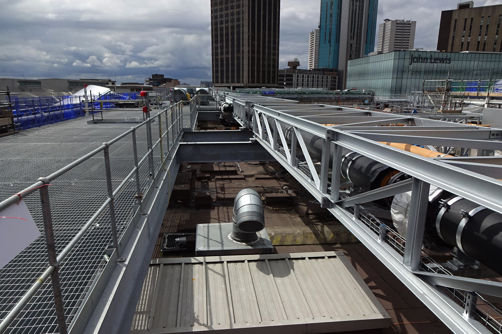
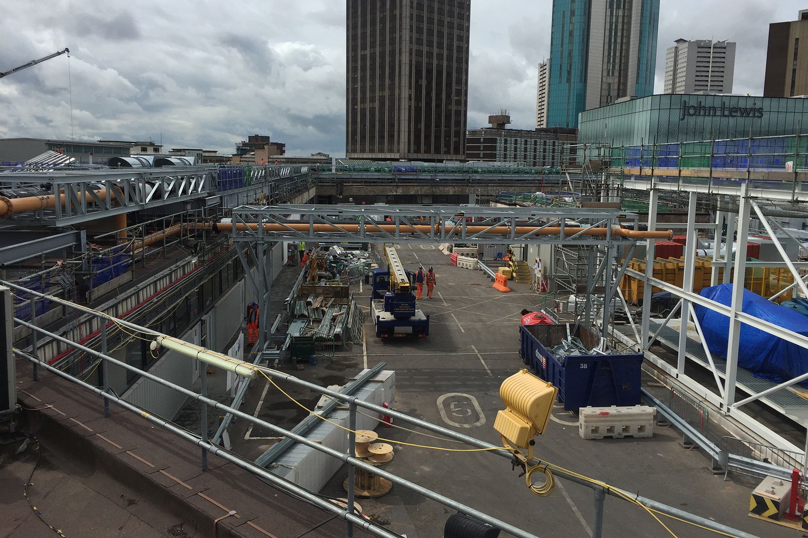

## Lead Structures Engineer 

Birmingham New Street Station, built during the 1960s, recently underwent a modernisation effort to significantly increase its daily passenger capacity, enhance the passenger experience, and improve connectivity within the city centre.

The redevelopment, completed in 2015, is widely recognised by its distinctive stainless-steel façades, featuring large media eye screens. The new concourse, which is now five times larger than the original, boasts a three-storey atrium that fills the station with natural light.

The construction works were led by Mace, with Atkins serving as the project's lead consultant. The Atkins structures team in London was responsible for designing the retail spaces on the concourse, ticket gate lines, front-of-house wayfinding and other floor mounted equipment, back-of-house ancillary structures, and for the structures required for the installation of a Combined Heat and Power plant (CHP) on the station's roof.

Some of the challenges encountered pertaining to the structure of the existing building included the absence of critical as-built information, material deterioration, limited load capacity, and the requirement for partial demolition of existing structural elements to accommodate the architect's vision and the addition of new services.

Our proposals included a comprehensive approach, involving the inspection, assessment, and strengthening of existing reinforced concrete (RC) and steel structures, modifications to existing structures, and the design and detailing of new RC and steel structures.

Effective collaboration with stakeholders, clients, contractors, and designers played a crucial role in successfully delivering the structural designs.

