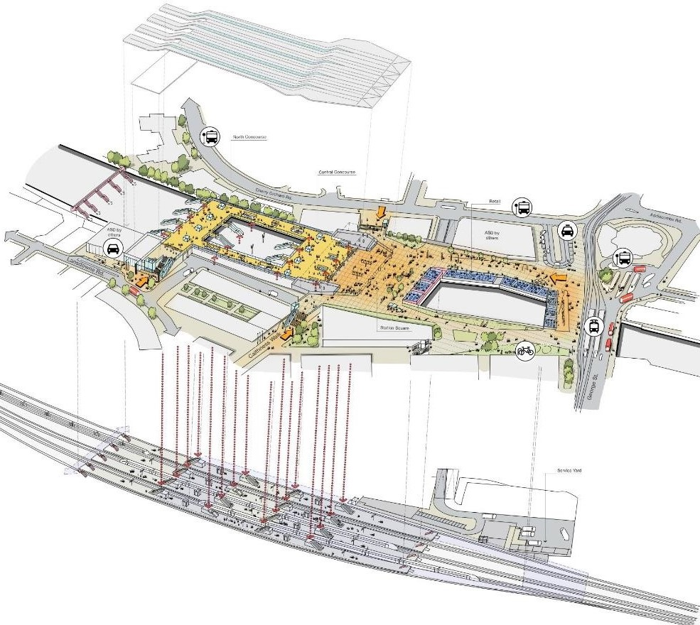
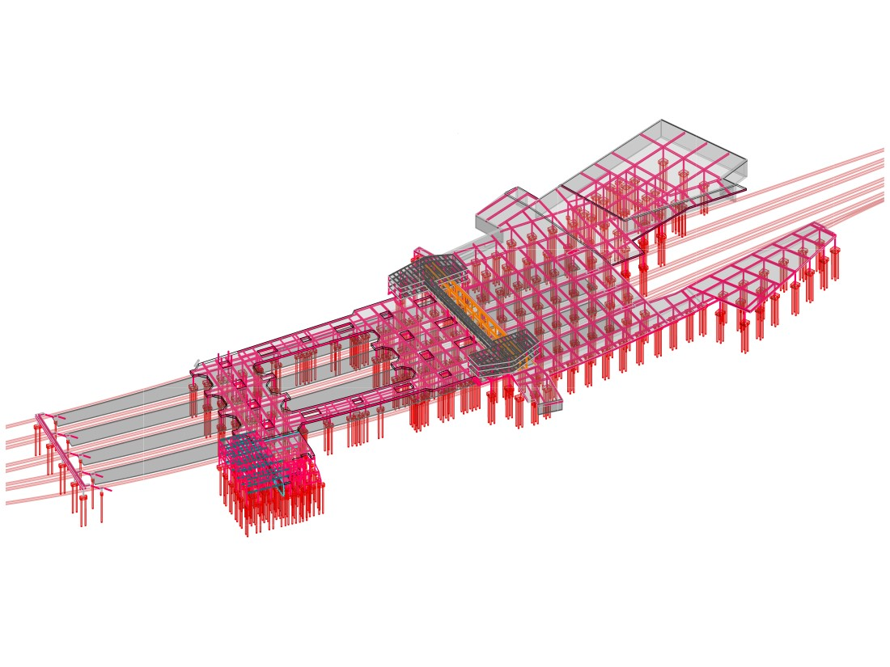
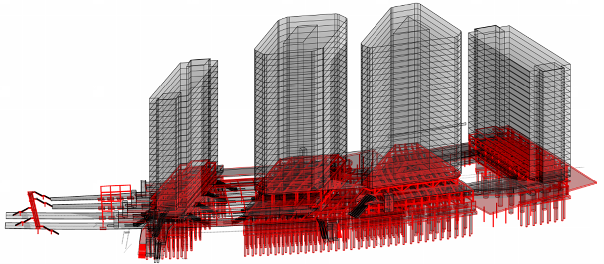
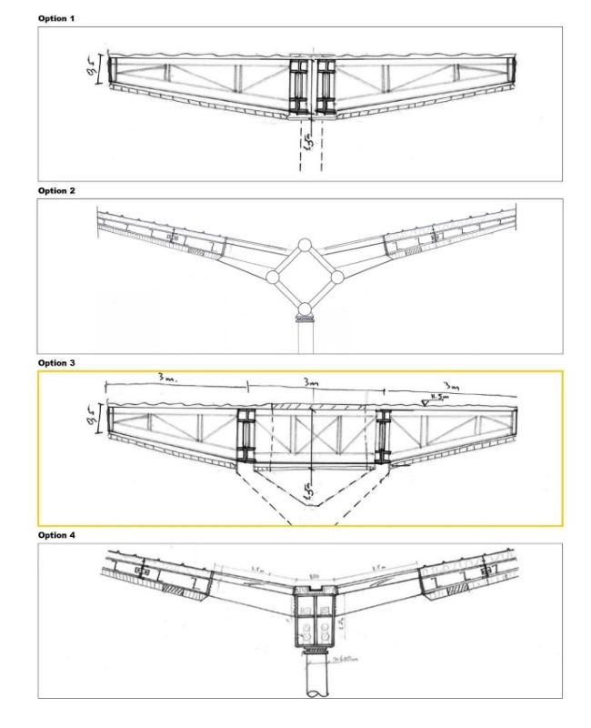
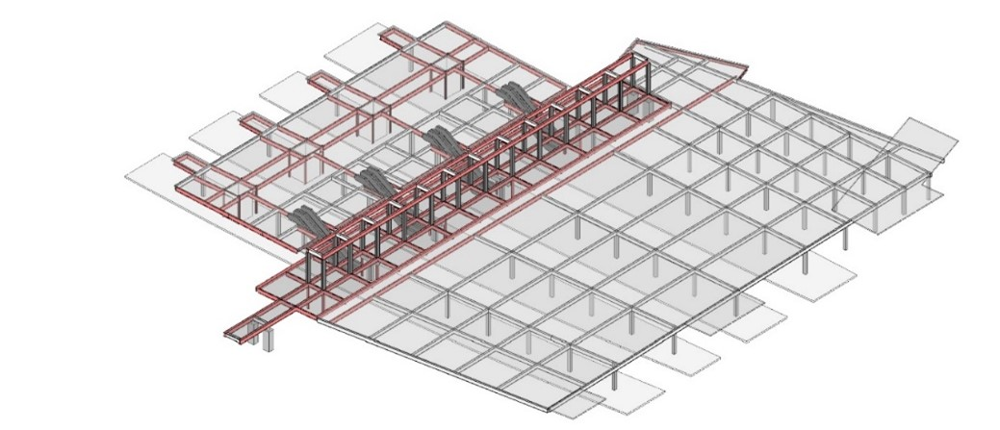
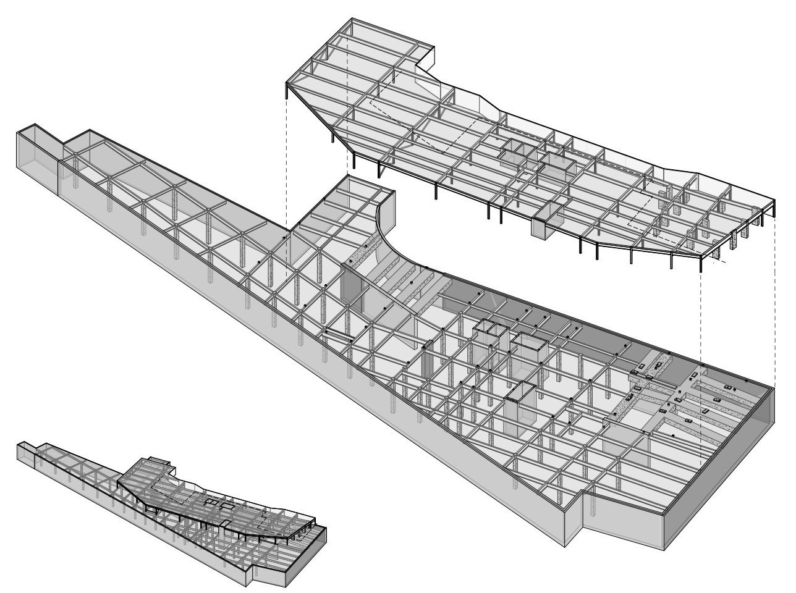
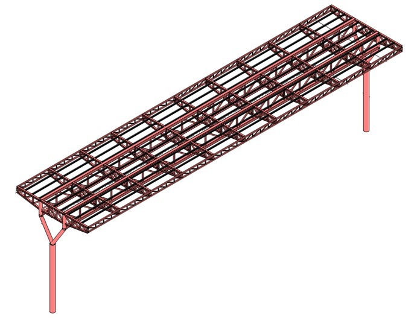

## Lead Structures Engineer

The project included a new high-standard station, with addition of two main lines, and several Over Site Development (OSD) high-rise buildings to enhance the commercial appeal of the proposal. NR tasked Atkins to undertake a multi-discipline single option selection design. Spyros was the lead structural engineer for GRIP 3, responsible for the delivery of the station structural package.

The proposed station’s structural frame was developed with the principle that columns could only be placed within the platforms, away from the platform edges. This approach aimed to maximize platform widths and minimise the physical dimensions of the columns by reducing the need for collision impact loading. The concourse spanned over eight tracks with limited supports at both ends and along the centreline of the island platforms.
Steel was chosen as the primary material for the structural elements due to its relatively light weight, offering advantages in terms of ease of lifting, reduced permanent loads, smaller and more cost-effective foundations, and faster construction.

The OSD component of the project consisted of four towers, ranging between 19 and 25 storeys, providing approximately 150,000 square meters of accommodation. The proposed OSD structures adhered to the same structural principles as the concourse deck, utilising a steel frame structure with large spans to minimize the number of internal columns. In later stages, the construction of the OSD was omitted due to the extended construction period and high costs associated with the substructure. 

Sustainability was a focal point of the project, considering the use of low-carbon concrete mixes that combined Portland cement with cement replacements like ground granulated blast furnace slag (GGBS) and pulverized fuel ash (PFA) to reduce the embodied carbon of the structure.

One of the primary challenges was designing the canopy roof over the station to provide a 40m long span with an optimised rigid structure to resist torsional forces. Additionally, the roof needed to be as light as possible to minimise the size of the foundations, and to be slender to allow for natural light. A crucial design criterion was that during the construction phase, each canopy segment over the island platforms should function as a self-supporting structure. To meet these requirements, Spyros developed an economical truss structure with a central boom, offering the most efficient depth-to-span ratio.

Media coverage of the project (external links):
<ul >
    <li><a href="https://www.networkrail.co.uk/running-the-railway/our-routes/sussex/upgrading-the-brighton-main-line/unblocking-the-croydon-bottleneck/" target="_blank" rel="noopener noreferrer">Network Rail: Unblocking the Croydon bottleneck</a></li>
    <li><a href="https://www.mylondon.news/news/south-london-news/huge-plan-transform-east-croydon-18940249" target="_blank" rel="noopener noreferrer">MyLondon: The huge plan to transform East Croydon station</a></li>
</ul>

---

