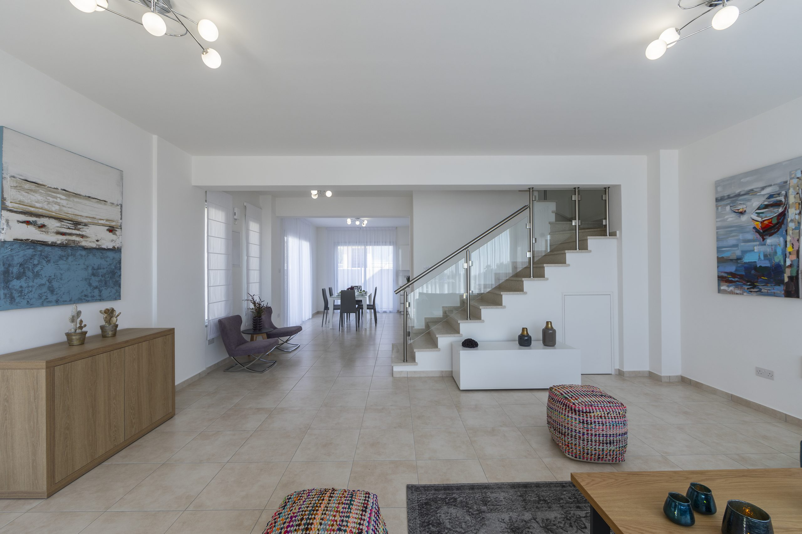
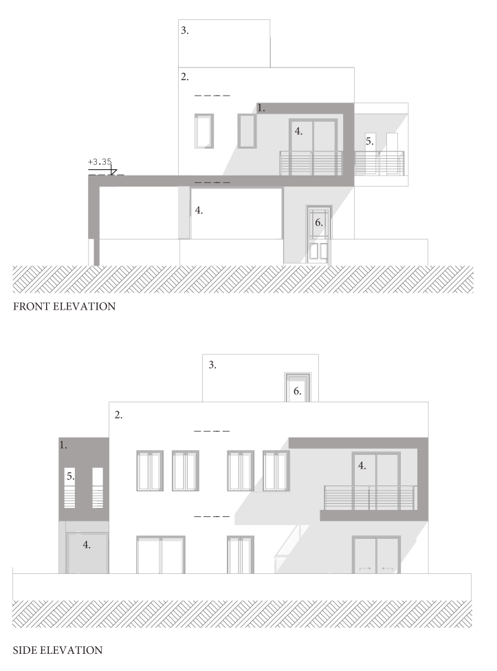

## Structural Engineer

Domenica Group, one of the largest property developers in Paphos (Cyprus), developed  several two-story detached villas situated in Paphos. The villas had a modern design with the interior layout emphasising in the creation of large openings to achieve open and well-ventilated spaces. Spyros was responsible for the structural design, generation of drawings and providing support to the on-site construction team.

These villas were constructed using reinforced concrete and pad foundations. The deliberate placement of interior shear walls enabled the displacement of columns to the perimeter. Additionally, low-profile beams were employed within the slab structure to mitigate deflection and eliminate protrusions.

Spyros also designed and generated the drawings for the drainage system, and managed the application and monitoring of planning permissions and construction permits.

