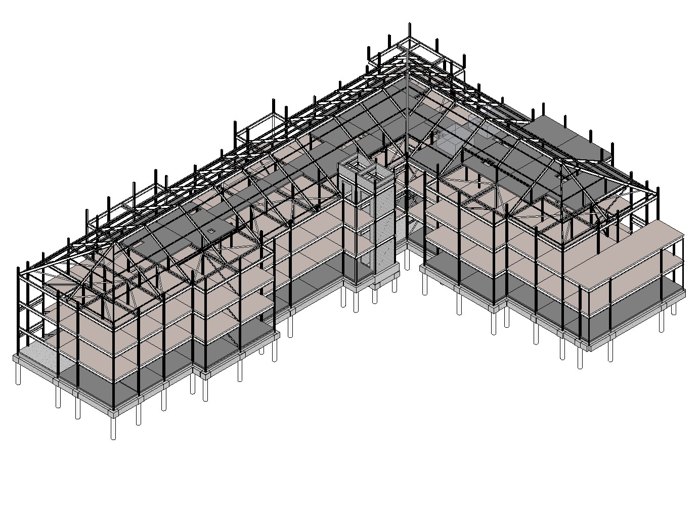
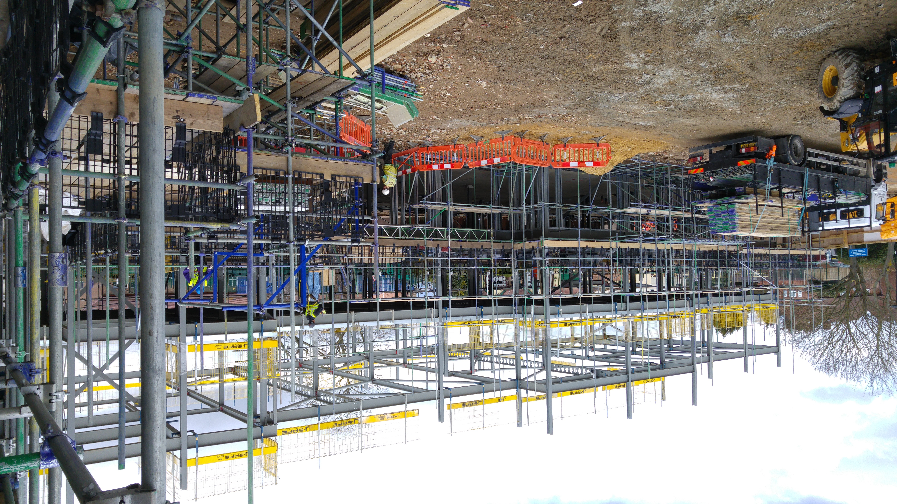
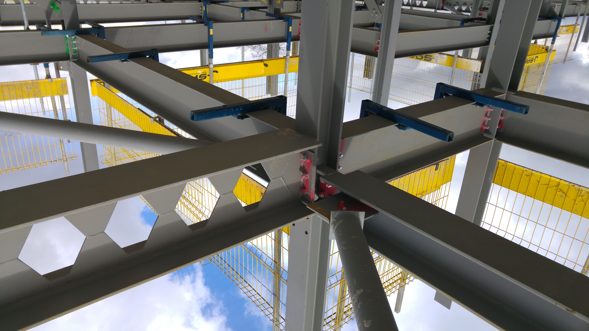
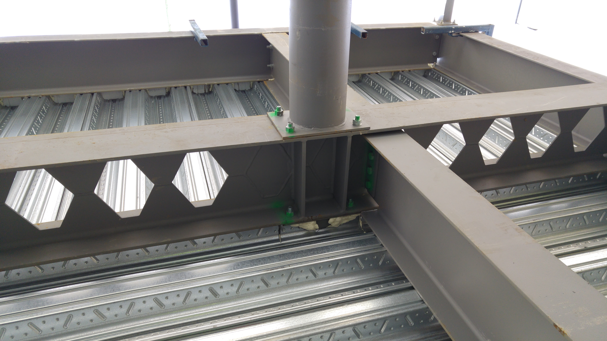
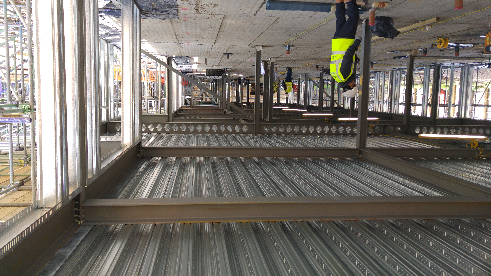

## Lead Structures Engineer (2014-2015)

The project involved the structural design of a three-story care home centre. This new-build development features 70 bedrooms and is owned and managed by The London Borough of Enfield (LBE). The building takes on a L-shaped layout with two residential wings. Spyros's responsibilities included creating a FE analysis model of the structure using Robot, developing a comprehensive Revit Structural model, leading coordination efforts for Architectural, MEP, and Structures BIM models, and producing a full set of structural drawings.

The design incorporated one large core at the center and two smaller cores at the outer edges of the wings. To enhance structural efficiency, a composite deck slab was specified for the first and second floors, allowing for diaphragm action to redistribute lateral loads to the bracing elements. The third floor, serving as the roof slab, was designed to house the MEP plant room within the pitched roof structure, which included large sprinkler tanks. To support the additional imposed loads, a deep precast hollowcore slab was chosen. Diaphragm action at the third floor was facilitated through shear connectors welded to the top flange of the beams, additional transverse reinforcement bars connecting to the plank cores, and a combination of horizontal bracing and moment connections.

The main contractor initially had reservations about adopting BIM due to concerns about increased costs. Spyros engaged with the Project Manager and presented the benefits of BIM, emphasising its alignment with government directives to implement Level 2 BIM by 2016 and the potential cost reduction by reducing waste and enhancing efficiency in design and construction.

