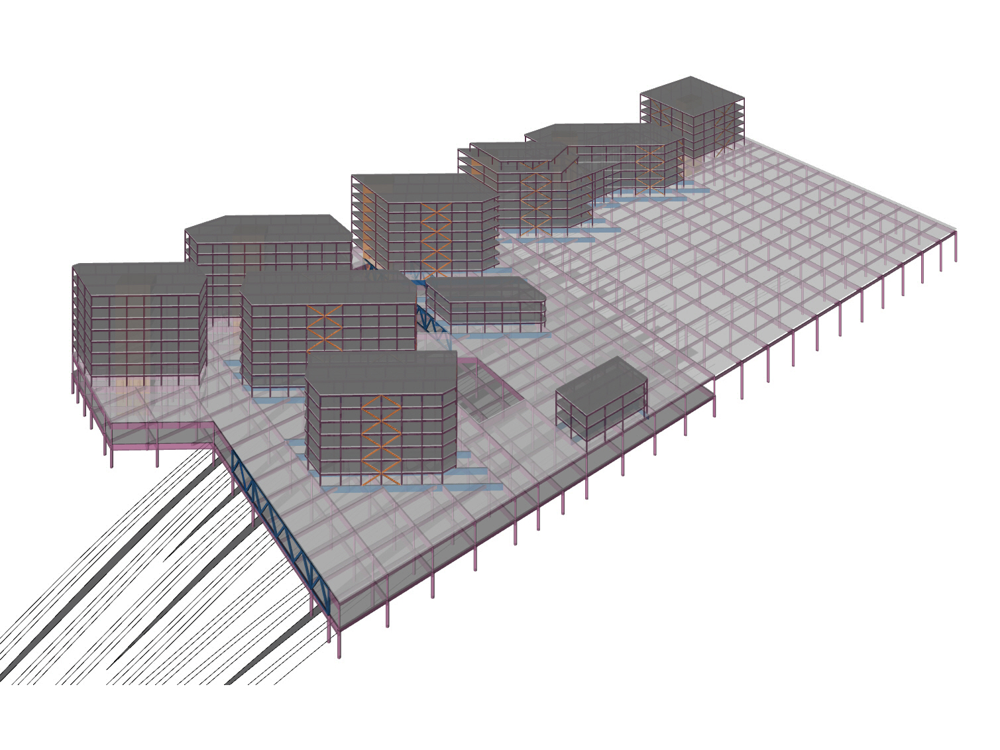
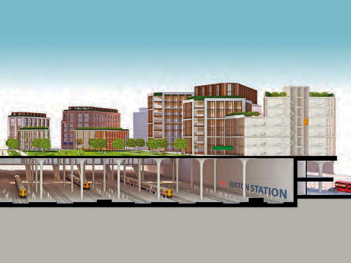
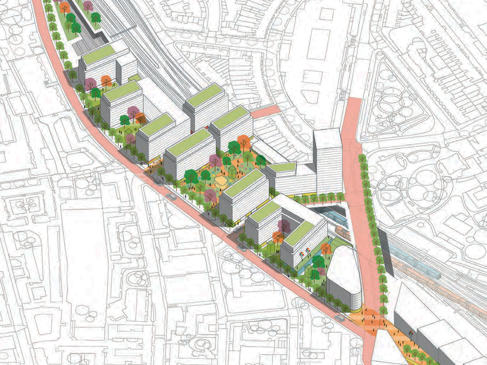
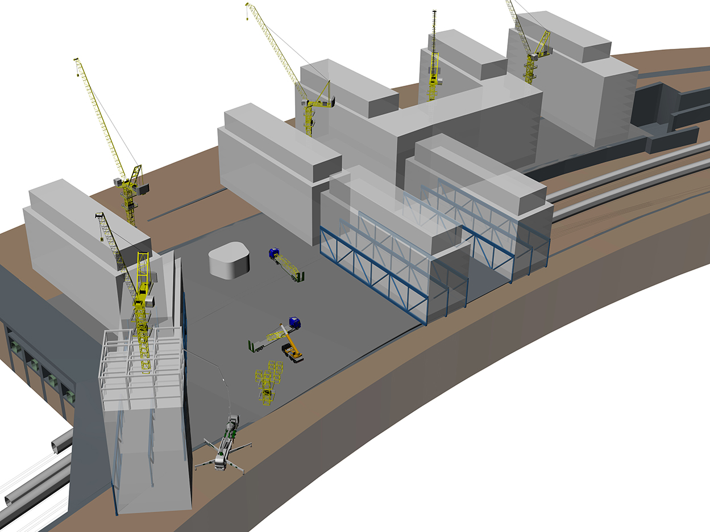

## Lead Structures Engineer

The construction of Euston HS2 station presents a unique opportunity to transform the existing Network Rail (NR) and London Underground (LUL) stations into a world-class transport hub with excellent interchange and onward travel connections. This transformation could seamlessly integrate with the surrounding streets, creating a high-quality gateway to Central London.

Currently, the station is only accessible from Euston Road, with no access on the other three sides of the site. This layout not only separates communities but also hinders local economic and social development.

To address these issues, Argent Related proposed a masterplan to establish a coherent urban framework by opening access on all sides of the site, reconnecting streets and communities previously seperated by the construction of NR railways. This vision could be realised by constructing a deck over the entire station footprint, allowing for greater opportunities for Over-Site Development (OSD) and the creation of public spaces.

Atkins has proposed a deck spanning over the existing railways to support a new NR concourse and OSD above. This deck will be supported by beams and columns on a regular grid, dictated by the platform spacing. In some locations where landing columns on the platforms is not possible due to structural gauge restrictions, storey-deep trusses will be introduced. The deck construction can be completed in a series of track possessions over time, before OSD construction begins. The OSD buildings will be supported on primary and secondary transfer beams and trusses, accommodating their skewed orientation relative to the column grid below.

The structures team supported the regeneration plan by conducting a feasibility study for the piled foundations, steel deck, and steel frames of the OSD buildings. This study considered site constraints, ongoing railway operations, and interfaces with other disciplines, resulting in an assessment of expected material usage for a construction cost estimate.

