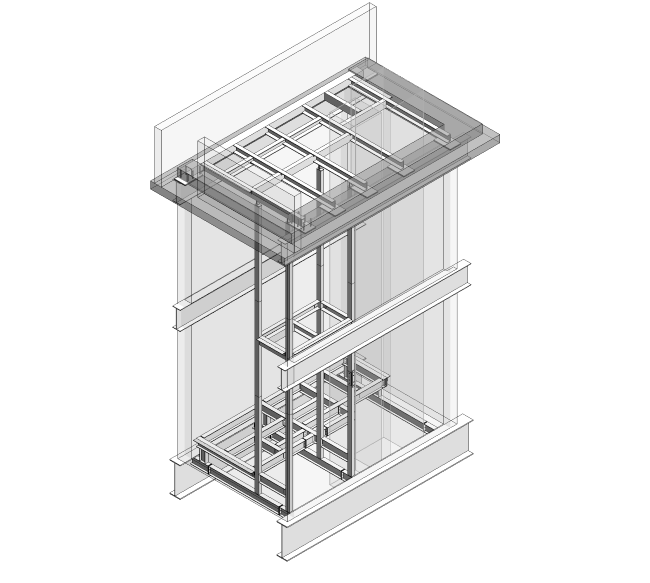
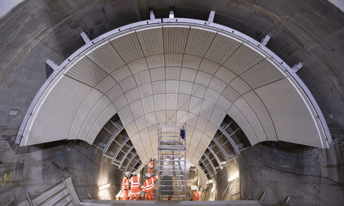

## Lead Structures Engineer

The Farringdon Station project is a significant inner-city transportation hub that is expected to become a major interchange station connecting Elizabeth Line, London Underground, and Thameslink.

Spyros was involved in the design and construction of various steel structures and elements across the entire station, such as CAT ladders, fall-arrest systems, platforms, and fixing testing equipment. These steel structures play a critical role in the overall functionality and safety of the station.

The design of these steel structures often required a non-standard approach and going beyond industry standards, indicating the project's complexity and uniqueness. To ensure the success of the project, there were frequent site visits, advanced Finite Element Method (FEM) modelling, and on-site testing to verify the structural integrity of these steel elements.

Throughout the design and construction of the project, the steel structures were central to the project's success.

