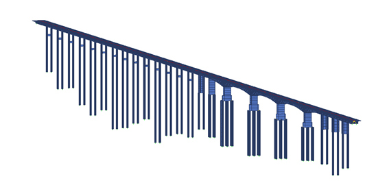
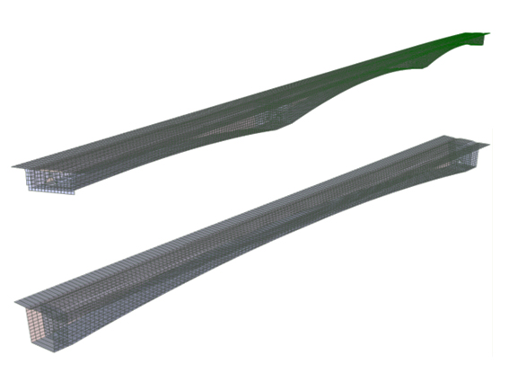
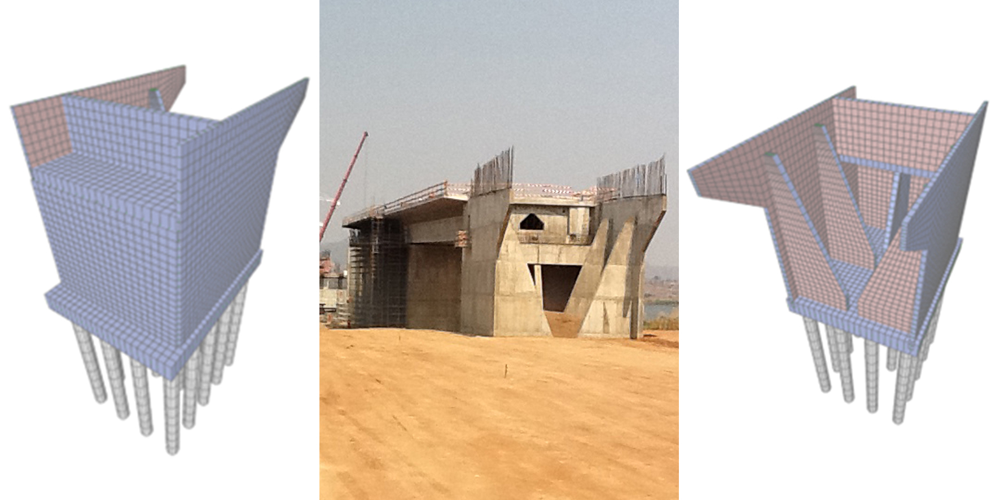

## Lead Structures Engineer/Reviewer

The Kassuende Bridge over Zambezi River in Mozambique serves as a crucial artery for road travel between Zimbabwe, Malawi, and Zambia, providing a bypass around the city of Tete. This new river crossing enhances the continuous economic growth of this region, underpinned by the thriving mining industry and the transportation of ore and coal between these countries.

The river crossing spans approximately 1,585m long, with the primary bridge covering approximately 715m and the access viaducts extending about 870m. The primary bridge consists of three continuous spans, with the longest spanning around 135m. The deck is in post-tensioned Reinforced Concrete (RC), featuring a variable-height box girder cross-section for the bridge and a consistent height for the viaducts. Construction employed a balanced cantilever method for the primary bridge and a launching girder for the viaducts, with the entire project being successfully completed in 2014.

In 2011, GAPRES was appointed by the main contractors, Mota Engil/Soares da Costa/Opway, to conduct an independent peer review of the original design by Betar. To carry out this review, we developed a Finite Element Model (FEM) of the bridge and viaducts using the FE Analysis (FEA) software RMBridge2006. This model facilitated a comprehensive longitudinal analysis of the deck, and analyses of the piers and piles, all in accordance with the design philosophy of the Southern Africa Transport and Communications Commission (SATCC). We carefully considered the heavy vehicular loads in this region and the seismic performance requirements. This model was also played a pivotal role in veryfing the design of the post-tension cables. We utilised FEA software SAP2000 to create additional FE Models to check the cross-sectional design of the deck and the design of the abutments.

