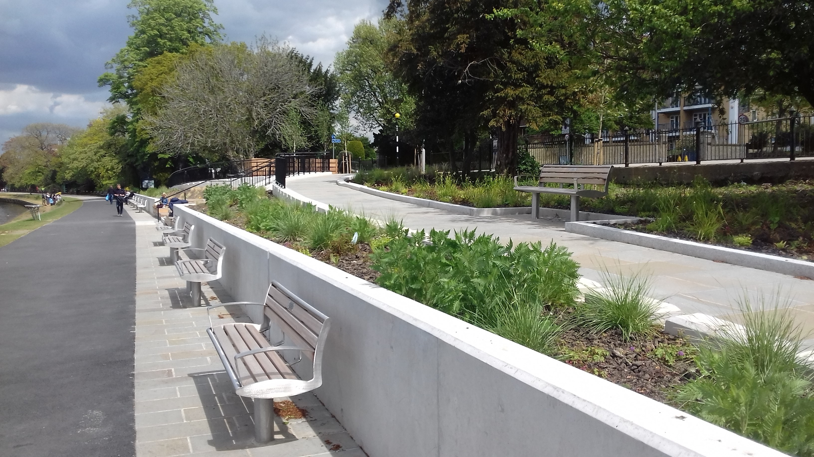
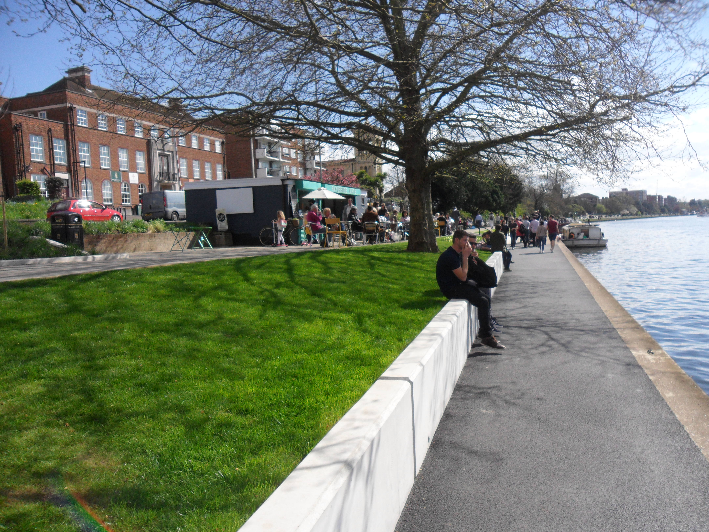
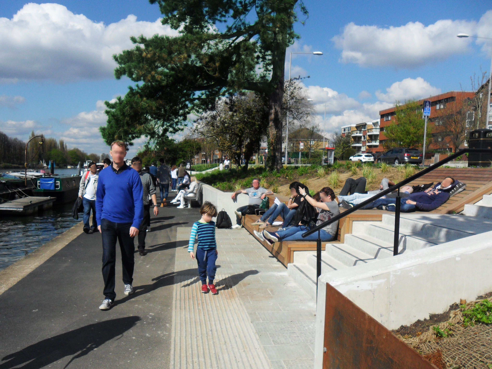

## Lead Structures Engineer

The Queens Promenade in Kingston runs parallel to the river Thames and used to be a wide route primarily for vehicles, providing access to central Kingston while acting as a divide between residential areas and the conservation area along the river. The Promenade faced some challenges, including limited accessibility, cracked footways, failing walls, and dilapidated seating.

To address these issues, the Mini Holland scheme, a funding initiative aimed at transforming outer London boroughs into cycling-friendly hubs with Dutch-style cycling infrastructure, was implemented. Its primary objective was to encourage cycling for short journeys. As part of this initiative, the Royal Borough of Kingston Upon Thames engaged Atkins to revitalise the riverfront and introduce segregated cycle lanes and improved access to the adjacent Queens Promenade.

Led by our dedicated Landscape Architecture team, we devised innovative solutions that included slender retaining walls to preserve mature trees, access ramps and stairs, ergonomically designed terraced seating seamlessly integrated into the landscape, and a comprehensive Sustainable Urban Drainage (SUDs) system to ensure effective drainage.

A pivotal aspect of the riverfront revitalisation was the careful selection of a material palette. Thus, one of our most significant contributions to the project was our input to the Material and Workmanship Specification. This ensured the desired finish for exposed reinforced concrete structures, weathering steel elements, and wooden cladding.

The successful delivery of this landmark project in 2017 was driven by the close collaboration between our Landscape Architecture and Structural Engineering teams. Their active engagement with Kingston Upon Thames, Transport for London (TfL), and the main contractor (Kier) played a crucial role in its accomplishment.

