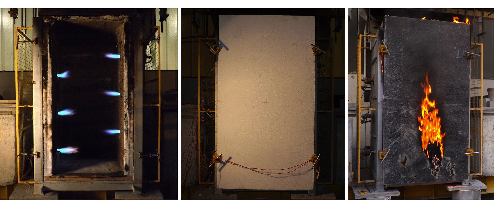
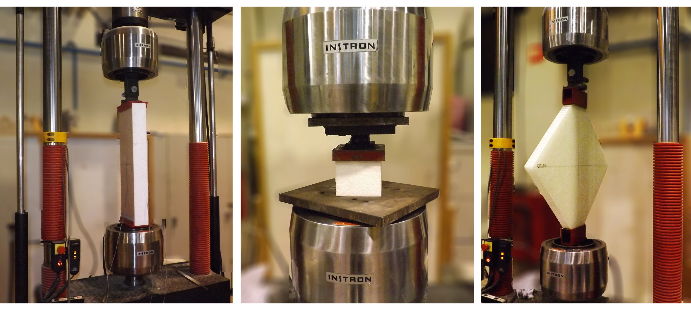
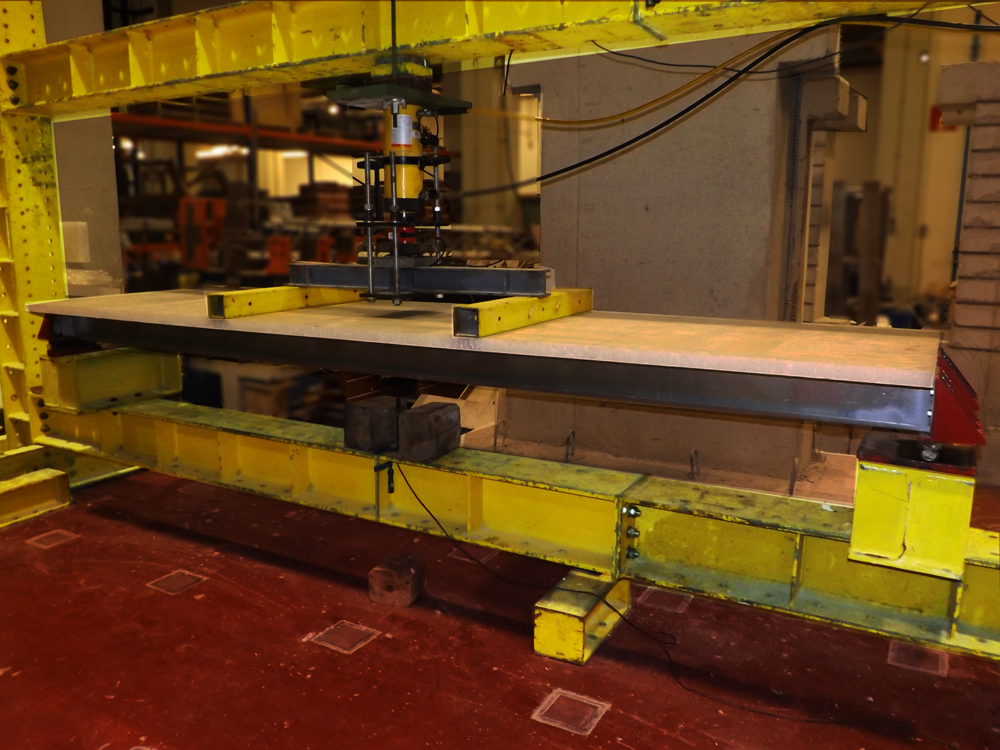

## Consultant 

The mass migration of people from rural areas to metropolitan centres is a global trend that will continue to accelerate. This rapid urbanization is driving the demand for affordable housing in mid- to high-rise buildings that are easy to procure and swift to construct.

To meet this housing demand, Modern Methods of Construction (MMC) using prefabricated modules offer the efficiencies necessary to reduce construction costs. Offsite fabrication in a controlled environment enhances productivity, reduces labour and waste, and improves quality assurance compared to traditional construction methods. It also reduces delays due to weather conditions and on-site accidents. Offsite fabrication contributes to environmental improvements to local communities by reducing noise, dust, and on-site vehicle movements. Modular construction enables the implementation of assembly lines, further lowering production costs through economies of scale.

Our consultancy services centred on the advancements of modular buildings. We have identified common materials and manufacturers, assessed existing and potential markets, and addressed relevant constraints for product implementation. We have also provided guidance on regulatory requirements for the design and construction of modular buildings in potential markets. Due to the need for certification of non-traditional construction materials in several countries, we have offered advice on material testing procedures to determine the mechanical properties and fire performance of various types of sandwich panels.

Our services have resulted in the construction of life-sized prototypes and the publication of scientific papers. These include '*Fire performance of sandwich wall assemblies*' in the *Journal of Composites Part B: Engineering* and '*Experimental characterisation of cork agglomerate core sandwich panels for wall assemblies in buildings*' in the *Journal of Building Engineering*.

